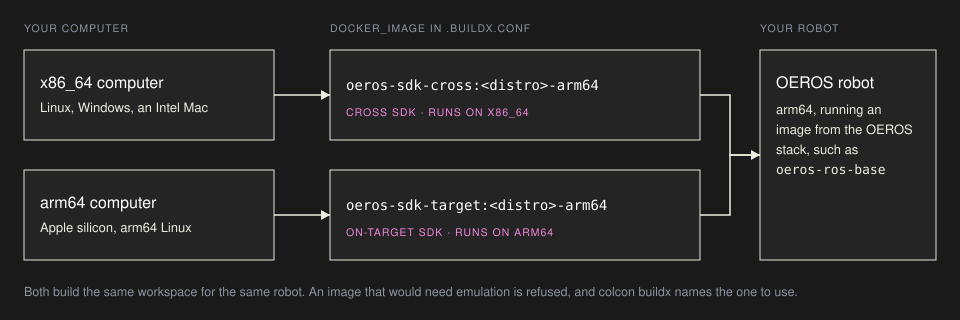
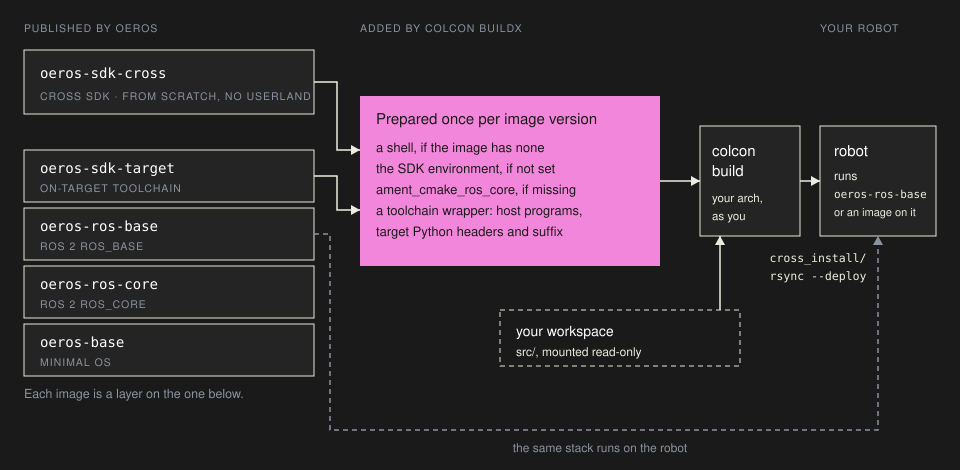

# OEROS robots

[OEROS](https://github.com/oerosproject) is a reference distribution for ROS 2 robots, built with Yocto and [meta-ros](https://github.com/ros/meta-ros). Besides the robot's own image, it publishes a stack of container images, from a minimal OS through `ros_core` and `ros_base` to development and SDK images, at `ghcr.io/oerosproject`. colcon buildx uses its SDK images to build your workspace on your computer for a robot that runs OEROS.

## Pick an image



The tag names the ROS 2 distro and the robot's architecture: `oeros-sdk-cross:lyrical-arm64` builds for an arm64 robot running OEROS Lyrical. On an arm64 computer, `oeros-sdk-target` builds the same workspace without cross-compiling, and it also generates Python bindings for your messages (see [Python and messages](#python-and-messages)).

## Build and deploy

In the workspace root, the directory that holds `src/`, create `.buildx.conf`:

```ini
method = docker
docker_image = ghcr.io/oerosproject/oeros-sdk-cross:lyrical-arm64
deploy_target = root@my-robot.local:/opt/ws/install/
```

```bash
colcon buildx            # builds into cross_build/ and cross_install/
colcon buildx --deploy   # then copies cross_install/ to the robot with rsync --delete
```

Arguments colcon buildx does not know, such as `--packages-select my_pkg`, go to `colcon build`. The first build with a new image takes a few seconds longer: colcon buildx prepares the image once, as below. `--deploy` needs `rsync` on the robot and a directory used for nothing else.

OEROS images use a POSIX shell, which cannot tell where a sourced script lives, so name the workspace when you source it on the robot:

```sh
. /opt/ros/lyrical/setup.sh
COLCON_CURRENT_PREFIX=/opt/ws/install . /opt/ws/install/local_setup.sh
ros2 run my_pkg my_node
```

## How colcon buildx works with an OEROS image



An SDK image needs to provide the cross toolchain and the robot's sysroot, nothing more. The build tools around them come from colcon buildx. The first time it meets an image version, it adds a thin layer, tagged `colcon-buildx:prepared-<id>`, with only what that image lacks:

- **a shell**, from a static BusyBox, when the image has none: `oeros-sdk-cross` is built from scratch;
- **the SDK environment** that meta-ros's `ros-sdk-env` would set: the CMake toolchain file, the target's Python ABI tag and the ROS 2 prefix in the sysroot;
- **`ament_cmake_ros_core`**, when the image's `rcutils` exports it and the image does not have it, built from `ros2/ament_cmake_ros` at the image's version.

Every build then goes through a toolchain wrapper: programs come from your computer, never from the robot's sysroot, and Python modules get the robot's headers and file names. Nothing runs under emulation, the build runs as your user, and `src/` is mounted read-only. When OEROS images carry these pieces themselves, colcon buildx finds them and adds nothing.

## Python and messages

meta-ros SDKs generate C and C++ code for messages, not Python. A message package you build with `oeros-sdk-cross` works from C++ nodes on the robot, but `rclpy` nodes and the `ros2` command line there cannot decode it. Message packages that Python must use belong in the robot's image, as recipes; `oeros-sdk-target` generates the Python bindings too. Python nodes themselves need no cross-build.

## Dependencies

A system library your packages need has to be in the robot's image, so it also has to be in the SDK built from that image. OEROS images are stacked, so add it where the stack is built, as a Yocto recipe or as a layer on the published image, and pin its version. `--install-deps` does not apply to SDK images.

## A board image

OEROS's own images and how to load them are in [its documentation](https://github.com/oerosproject/meta-oeros/blob/main/docs/containers.md). For a board image to flash, the Kria K26 builds in this project use meta-ros's kas configurations; the Yocto boards guide on the [documentation site](https://smarobix.github.io/smarobix-buildx-images/guides/yocto/) has the steps.

## Your own image

Any OE/Yocto SDK in a Docker image works the same way, your own builds included. colcon buildx reads a few labels from the image, together with its architecture:

| Label | Values | Effect |
|---|---|---|
| `org.smarobix.buildx.kind` | `oe-sdk`, or absent | `oe-sdk`: an SDK image, prepared as above. Absent: a board image (see below). |
| `org.smarobix.buildx.env-setup` | absolute path in the image | The SDK's `environment-setup-*` script. Optional: colcon buildx also looks under `/usr/local/*/` and `/opt/`. |
| `org.smarobix.buildx.ros-distro` | `jazzy`, `lyrical`, … | Which `/opt/ros/<distro>` to use, ahead of a distro in the image's name. |
| `org.smarobix.buildx.target-platform` | `linux/arm64`, `linux/arm/v7` | What the output runs on; printed at build time. |
| `io.oeros.sdk`, `io.oeros.ros-distro` | set by OEROS | `io.oeros.sdk=cross` counts as `oe-sdk`. |

```dockerfile
LABEL org.smarobix.buildx.kind="oe-sdk" \
      org.smarobix.buildx.env-setup="/opt/ros-sdk/environment-setup-cortexa72-cortexa53-oe-linux" \
      org.smarobix.buildx.ros-distro="jazzy"
```

An SDK image has to be built for the architecture of the computer that runs it: an SDK built with `SDKMACHINE = "x86_64"` for x86_64 computers, `aarch64` for arm64 ones. colcon buildx refuses an SDK image for the other architecture rather than emulating it.

Without those labels, an image is a board image: a board's userspace with ROS 2 in `/opt/ros/<distro>`. If it has your computer's architecture, the build runs in it as it is. If not, and it is an Ubuntu or Debian image, colcon buildx copies its filesystem into a cross image built from the same release with that release's cross compiler, tagged `colcon-buildx:cross-<id>`. Copying a filesystem runs nothing from it. The build runs as your user with `HOME=/tmp`, so the image must not need a particular user.

To see an image's labels: `docker image inspect --format '{{json .Config.Labels}}' IMAGE`.
